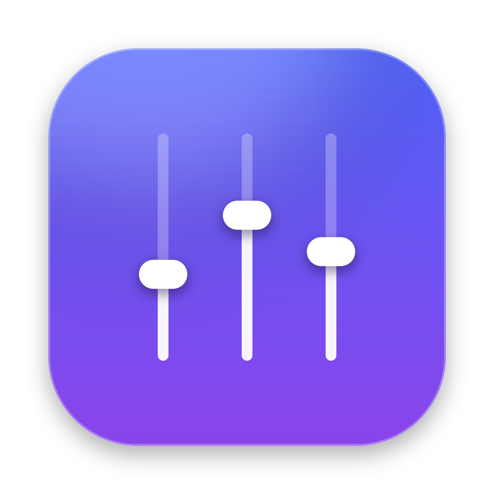

<p align="center">
  
</p>

<h1 align="center">Faders</h1>

<p align="center">
  <b>The volume mixer macOS never had.</b><br>
  Turn each app up or down from the menu bar — like the Windows Volume Mixer, redesigned for macOS Tahoe's Liquid Glass.
</p>

<p align="center">
  <a href="../../releases/latest">Download</a> ·
  <a href="#how-it-works">How it works</a> ·
  <a href="#build-from-source">Build from source</a>
</p>

---

## Features

- **Per-app volume** — a slider for every app that's playing sound: Spotify, Safari, Zoom, games, anything.
- **Mute any app** with one click, without touching the others.
- **Master volume** for your current speakers or headphones, right on top.
- **Remembers your levels** — set Slack to 30% once and it stays there.
- **Follows your output** — plug in headphones or switch to AirPods and everything keeps working.
- **Liquid Glass design** on macOS 26, with a clean frosted look on macOS 14–15.
- **Lightweight & private** — no Dock icon, no network access, no audio is ever recorded or saved.
- **Free and open source** (MIT).

## Install

1. Download **Faders.zip** from the [latest release](../../releases/latest) and unzip it.
2. Drag **Faders.app** into your **Applications** folder.
3. The first time, **right-click → Open** (the app is free and not notarized by Apple, so macOS asks once).
4. Click the <kbd>⧉ sliders</kbd> icon in your menu bar.

The first time you lower an app's volume, macOS asks for permission to access app audio. Click **Allow** — that's what lets Faders change the app's level. You can review it any time in **System Settings → Privacy & Security → Screen & System Audio Recording**.

> **Tip:** Hold <kbd>⌘</kbd> and drag the icon in the menu bar to put it right next to Control Center. Turn on **Open at Login** in the panel so it's always there.

**Requirements:** macOS 14.4 Sonoma or newer. Liquid Glass styling appears on macOS 26 Tahoe.

## How it works

macOS has no built-in per-app volume, so Faders uses **Core Audio process taps** (added in macOS 14.2):

```
App ──► process tap ──► × your volume ──► speakers / headphones
```

1. When you move an app's slider below 100%, Faders creates a *tap* for that app. The tap takes over the app's sound so it doesn't also reach the speakers directly.
2. The tap is wrapped in a private *aggregate device* together with your real output device.
3. A tiny real-time callback copies the audio to the output, multiplied by your volume, with a smooth ramp so there are no clicks.

Apps you never touch are left completely alone, and **Reset All** removes every tap and returns all apps to normal.

## Project layout

The code is small and commented — start with `MixerModel.swift`.

```
Sources/Faders/
├── FadersApp.swift              App entry point (menu bar item)
├── MixerModel.swift             State: which apps, what volume, keeps taps in sync
├── Audio/
│   ├── AppVolumeTap.swift       Per-app volume via Core Audio process taps
│   ├── AudioAppScanner.swift    Finds apps using audio, groups helper processes
│   ├── OutputDevice.swift       Master volume / mute of the current output
│   └── CoreAudio+Helpers.swift  Readable wrappers around Core Audio's C API
└── Views/
    ├── MixerView.swift          The dropdown panel
    ├── VolumeRow.swift          One slider row
    └── Glass.swift              Liquid Glass with fallback for older macOS
```

## Build from source

You need **Xcode 26** (or newer) on macOS.

```bash
git clone https://github.com/nixocode/Faders.git
cd Faders
./scripts/build-app.sh      # → build/Faders.app
open build/Faders.app
```

Or open `Package.swift` in Xcode and press **Run**. (When running from Xcode the permission prompt may not appear; use the built `.app` to test per-app volume.)

Every push is built automatically on GitHub's macOS runners — see the **Actions** tab. Pushing a tag such as `v1.0.1` publishes a new release.

## Known limitations

- Very new or unusual output devices with more than 2 channels may not route correctly while an app is turned down. Reset the app to 100% to restore normal audio.
- Some apps play sound through a shared system process (for example Safari's web content via WebKit). Those appear under the process's own name.
- Apps with their own exclusive audio engines (pro audio software) may ignore taps.

## Contributing

Issues and pull requests are welcome. Please keep the code simple and commented — readability is a feature of this project.

## License

[MIT](LICENSE) — free to use, modify and share.
