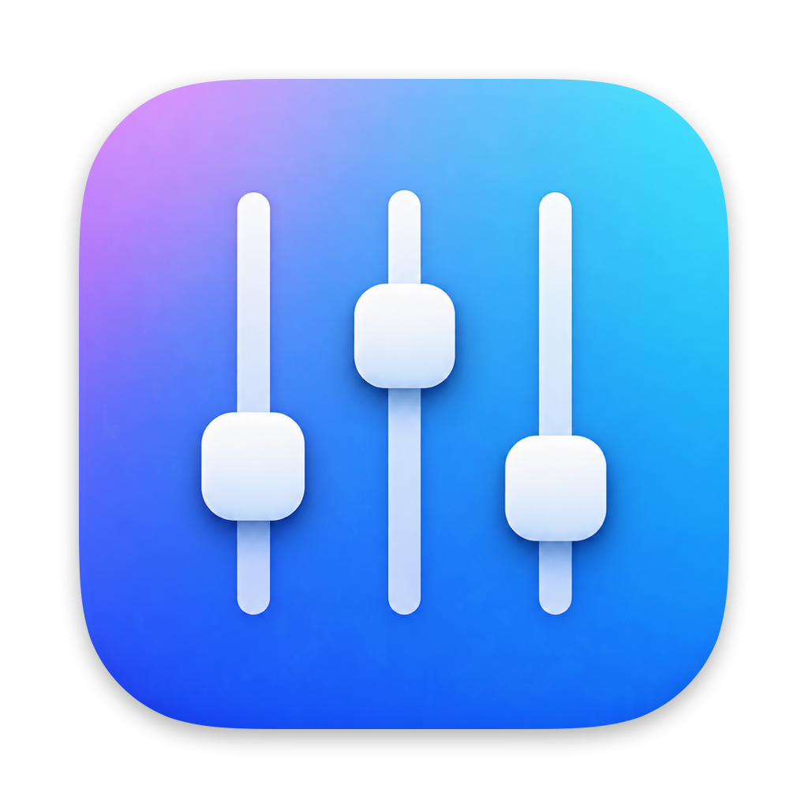

<p align="center">
  
</p>

<h1 align="center">Faders</h1>

<p align="center">
  <b>The volume mixer macOS never had.</b><br>
  Turn each app up or down from the menu bar — like the Windows Volume Mixer, designed for the Liquid Glass look of macOS 27 Golden Gate.
</p>

<p align="center">
  <a href="#install">Install</a> ·
  <a href="#is-it-safe">Is it safe?</a> ·
  <a href="#how-it-works">How it works</a> ·
  <a href="#build-from-source">Build from source</a>
</p>

---

## Features

- **Per-app volume** — a slider for every app that's playing sound: Spotify, Safari, Zoom, games, anything.
- **Mute any app** with one click, without touching the others.
- **Master volume** for your current speakers or headphones, right on top.
- **Remembers your levels** — set Slack to 30% once and it stays there.
- **Follows your output** — plug in headphones or switch to AirPods and everything keeps working.
- **Swipe to adjust** — two fingers on the trackpad over a row move its slider, the same way pages scroll (it follows your Natural scrolling setting).
- **Sliders that feel even** — 50% sounds about half as loud, like the system volume.
- **Keyboard and VoiceOver** — <kbd>Tab</kbd> moves between rows, <kbd>←</kbd> <kbd>→</kbd> change the level, <kbd>M</kbd> mutes.
- **Native look** — one Liquid Glass panel drawn by macOS itself, so it follows your appearance, Reduce Transparency and Increase Contrast settings.
- **Lightweight** — a download under 1 MB, no Dock icon, under 40 MB of memory, and no CPU at all while nothing is playing.
- **Free and open source** (MIT).

## Install

**Requirements:** macOS 14.4 Sonoma or newer. Built for macOS 27 Golden Gate; the Liquid Glass look appears on macOS 26 and later.

### Option A — with git (recommended)

Open **Terminal** and paste:

```bash
git clone https://github.com/nixocode/nixocode-Faders.git Faders
cd Faders
./scripts/install.sh
```

That builds Faders on your Mac from the source you just downloaded and puts it in your Applications folder. If macOS offers to install the **Command Line Tools** when you run `git`, click **Install** and run the commands again (it's Apple's free developer toolkit; you don't need the full Xcode).

To update later: `cd Faders && git pull && ./scripts/install.sh`.

### Option B — download the app

1. Download **Faders.zip** from the [latest release](../../releases/latest) and unzip it.
2. Drag **Faders.app** into your **Applications** folder and open it.
3. macOS says it can't verify the app, because Faders isn't signed with a paid Apple developer certificate. Click **Done**, then open **System Settings → Privacy & Security**, scroll down and click **Open Anyway** next to Faders. You only do this once.

### First use

Click the three-sliders icon in your menu bar. The first time you turn an app down, macOS asks whether Faders may access other apps' audio (that app stays quiet until you answer). Click **Allow**: that's what lets Faders change an app's level. Because Faders isn't signed with a paid developer certificate, macOS may ask again after you update it.

If you click **Don't Allow**, nothing breaks: your apps keep playing normally and Faders shows a link to the setting. You can change it any time in **System Settings → Privacy & Security → Screen & System Audio Recording**.

> **Tip:** Hold <kbd>⌘</kbd> and drag the icon in the menu bar to put it right next to Control Center. Turn on **Open at Login** in the panel so it's always there.

## Is it safe?

- **Nothing is recorded, saved or sent.** Audio only passes through memory on its way to your speakers. Faders contains no networking code at all.
- **Apps you don't touch are left alone.** Faders only steps in for an app once you move its slider away from 100%.
- **Your sound always comes back.** The audio taps Faders creates are private to it, and macOS removes them the moment Faders quits or crashes, so every app goes back to playing normally. **Reset All** does the same at any time.
- **It never leaves an app silent by mistake.** If macOS doesn't let Faders hear an app (for example, you clicked Don't Allow), Faders notices that only silence comes through, lets the app go and shows the permission hint.
- **Small enough to read.** About 1,900 lines of commented Swift and one dependency, Apple's own [swift-atomics](https://github.com/apple/swift-atomics). Release builds are made by [GitHub Actions](.github/workflows/build.yml) from this public source.

## How it works

macOS has no built-in per-app volume, so Faders uses **Core Audio process taps** (added in macOS 14.2):

```
App ──► process tap ──► × your volume ──► speakers / headphones
```

1. When you move an app's slider below 100%, Faders creates a *tap* for that app. The tap takes over the app's sound so it doesn't also reach the speakers directly.
2. The tap is wrapped in a private *aggregate device* together with your real output device.
3. While the app plays, a tiny real-time callback copies its audio to the output, multiplied by your volume, with a smooth ramp so there are no clicks.

Back at 100% (or after **Reset All**), the tap is removed and the app plays exactly as before.

**About the purple dot.** While Faders is *reading* an app's audio, macOS shows a purple privacy dot in the menu bar (it means "an app is capturing audio"). Faders keeps the dot off as much as it can: it only reads an app while that app is actually playing, and stops 3 seconds after it goes quiet. A paused app keeps its tap, silent and unread, so it doesn't blast out at full volume for a moment when it starts again.

## Project layout

The code is small and commented — start with `MixerModel.swift`.

```
Sources/Faders/
├── FadersApp.swift              App entry point (menu bar item)
├── MixerModel.swift             State: which apps, what volume, keeps taps in sync
├── Audio/
│   ├── AppVolumeTap.swift       Per-app volume via Core Audio process taps
│   ├── TapRenderer.swift        The real-time part: copies audio × volume
│   ├── AudioAppScanner.swift    Finds apps using audio, groups helper processes
│   ├── ProcessMonitor.swift     Notices apps starting and stopping sound
│   ├── OutputDevice.swift       Master volume / mute of the current output
│   ├── PropertyListener.swift   Core Audio change notifications
│   └── CoreAudio+Helpers.swift  Readable wrappers around Core Audio's C API
└── Views/
    ├── MixerView.swift          The dropdown panel
    ├── VolumeRow.swift          One slider row
    └── RowBackground.swift      The quiet fill behind each row
```

## Build from source

You need macOS with Apple's **Command Line Tools** (`xcode-select --install`) or **Xcode 26** or newer.

```bash
./scripts/build-app.sh      # → build/Faders.app and build/Faders.zip
./scripts/install.sh        # builds, then installs in Applications and opens it
swift test                  # runs the unit tests (needs Xcode)
```

With Xcode the app is universal (Apple silicon and Intel). With only the Command Line Tools it's built for your own Mac, because recent Command Line Tools no longer include everything an Intel build needs.

You can also open `Package.swift` in Xcode and press **Run**. (When running from Xcode the permission prompt may not appear; use the built `.app` to test per-app volume.)

Every push and pull request is built and tested on GitHub's macOS runners — see the **Actions** tab. Pushes to `main` publish the release for the version in `Support/Info.plist`; bump `CFBundleShortVersionString` to ship a new one.

## Known limitations

- Output devices with unusual channel layouts may not route correctly while an app is turned down. Reset the app to 100% to restore normal audio.
- If a new app starts playing while the panel is open, the panel grows at once instead of smoothly (macOS doesn't let menu bar panels animate their size).
- Apple's background services (Siri dictation, system sounds and similar) are hidden on purpose: they keep audio connections open but aren't apps you'd want a slider for.
- Apps with their own exclusive audio engines (pro audio software) may ignore taps.

## Contributing

Issues and pull requests are welcome. Please keep the code simple and commented — readability is a feature of this project.

## License

[MIT](LICENSE) — free to use, modify and share.
